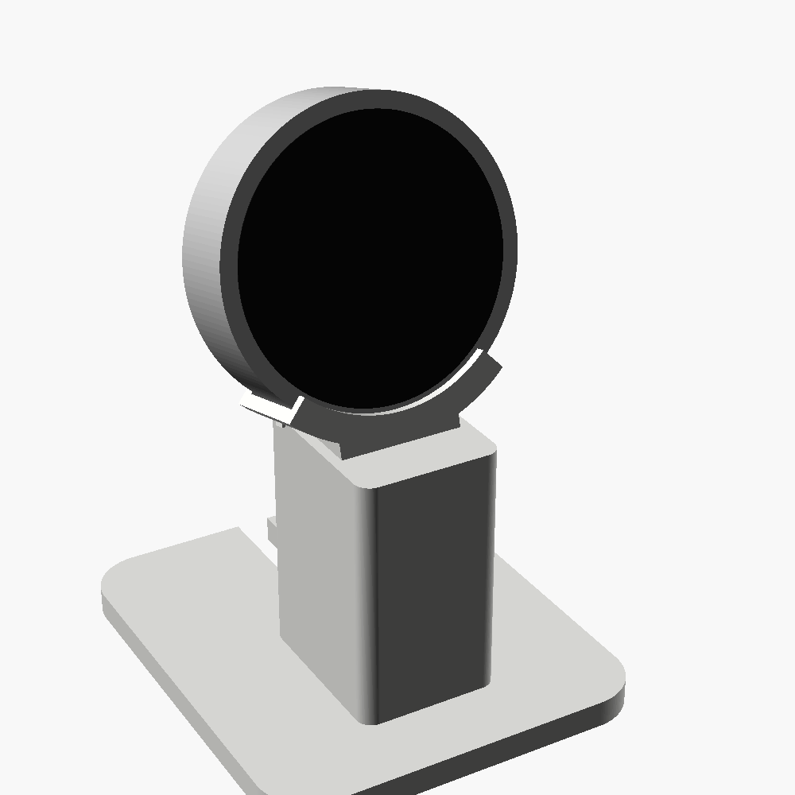

# Desk stand for the 1.75C dial

A stand for the Waveshare ESP32-S3-Touch-AMOLED-1.75C (the one in the round aluminum case). The dial sits in a
shallow cup, tilted back 15°, with its USB-C port facing down. The cable runs down inside the stand and leaves
through a slot at the back of the base, so only the dial shows from the front.

## Printing

- File: [dial-stand.stl](dial-stand.stl). Print it as it comes, base down. No assembly.
- PLA or PETG, 0.2 mm layers, 3 walls, 15 % infill. About 72 × 84 mm footprint, 11 cm tall with the dial in.
- The roof inside the pedestal is a short bridge. Supports only if the printer bridges poorly.

## Fitting

1. Feed the cable's USB-C end up from under the base, through the hollow pedestal and out the slot in the cup.
2. Plug it into the dial and set the dial in the cup, screen forward.
3. Lay the cable in the slot along the bottom of the base so it leaves at the back.

It is made for a normal straight USB-C plug (up to about 18 × 12 mm). The cup stays clear of the two side buttons.

## Adjusting

[dial-stand.scad](dial-stand.scad) is the editable source for [OpenSCAD](https://openscad.org) (free). The
numbers at the top change the fit: `clearance` if the dial is tight or loose, `tilt` for the lean, `lift` for the
height, `slot` for a bulkier plug. Case size comes from Waveshare's drawing: 55.00 mm across, 15.05 mm thick.
